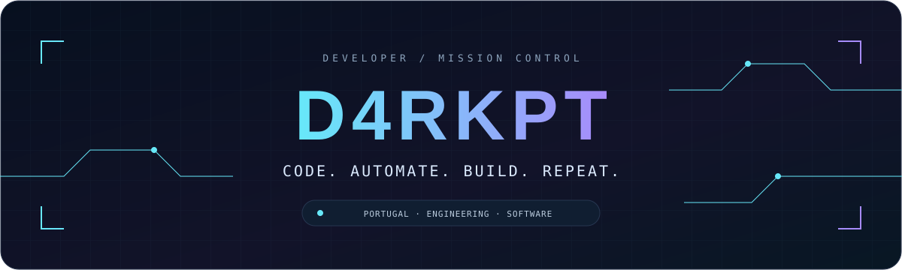
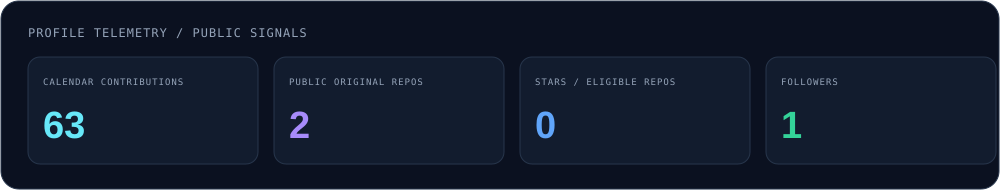
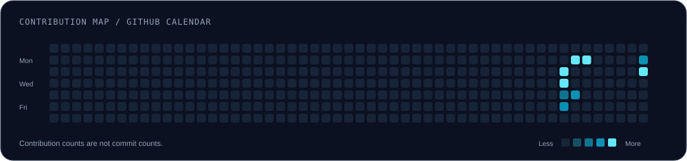
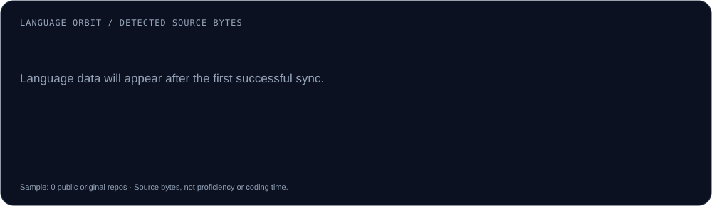
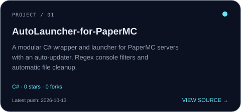
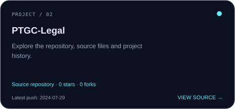

<!-- D4RKPT / MISSION CONTROL — generated sections are updated by scripts/update_profile.py -->

  

  
  
  
  

  <samp>PORTUGAL / AUTOMATION &amp; SOFTWARE</samp> 
  Engineering student. Practical projects. A little less friction, a lot more possibility.

---

## 🧭 The person behind the code

I'm an Automation, Control and Instrumentation Engineering student in Portugal.
I enjoy turning repetitive tasks into tools, building software that feels good to use,
and figuring out why things break — then making them better.

- ⚙️ Automation, useful utilities and lightweight desktop applications.
- 🤖 Discord bots with JavaScript and discord.js v14.
- 🎮 Game-related tools and experiments.
- 🧪 Learning through coursework, prototypes and real debugging sessions.

> Build something useful. Make it clear. Make it faster. Keep iterating.

## 🧬 Technology arsenal

  &nbsp;&nbsp;
  &nbsp;&nbsp;
  &nbsp;&nbsp;
  &nbsp;&nbsp;
  &nbsp;&nbsp;
  &nbsp;&nbsp;
  

<samp>JavaScript · C · C# · Python · C++ · Java · HTML5</samp>

⚙️ What I like building with them

 

| Area | Interests & tools |
| :--- | :--- |
| Bots & automation | JavaScript · Node.js · discord.js v14 |
| Desktop utilities | C# · .NET · WinForms / WPF |
| Scripts & experiments | Python |
| Programming fundamentals | C · C++ · Java |
| Web interfaces | HTML5 · JavaScript |

These are the technologies I use or study — not a claim that I am an expert in all of them.

## 📡 Live telemetry

<picture>
  <source media="(prefers-color-scheme: dark)" srcset="assets/dashboard-dark.svg" />
  <source media="(prefers-color-scheme: light)" srcset="assets/dashboard.svg" />
  
</picture>

<!-- SNAPSHOT:START -->
Last successful sync: 2026-10-13 UTC · Contribution period: 2025-10-12 → 2026-10-13 · Projects ordered by latest push.
<!-- SNAPSHOT:END -->

<picture>
  <source media="(prefers-color-scheme: dark)" srcset="assets/contributions-dark.svg" />
  <source media="(prefers-color-scheme: light)" srcset="assets/contributions.svg" />
  
</picture>

<picture>
  <source media="(prefers-color-scheme: dark)" srcset="assets/languages-dark.svg" />
  <source media="(prefers-color-scheme: light)" srcset="assets/languages.svg" />
  
</picture>

🔎 How these numbers are calculated

 

- Contributions come from GitHub's contribution calendar API. Contributions are not the same as commits.
- The project selection includes public, original, non-archived repositories and excludes this profile repository.
- Stars are summed across those eligible repositories.
- Language percentages use GitHub's detected source bytes across up to 40 eligible repositories, ordered by recent push date. They do not measure skill or time spent coding.
- Recent activity comes from the public events feed; it is a selection, not a complete commit history.
- Dashboard images live in this repository. No external statistics-card server is needed.

## 🚀 Projects

Public projects, refreshed automatically. Start with the source — then make it your own.

<!-- PROJECTS:START -->
<table>
<tr>
<td width="50%"><a href="https://github.com/D4rkpt/AutoLauncher-for-PaperMC"><picture><source media="(prefers-color-scheme: dark)" srcset="assets/project-1-dark.svg" /><source media="(prefers-color-scheme: light)" srcset="assets/project-1.svg" /></picture></a></td>
<td width="50%"><a href="https://github.com/D4rkpt/ptgc"><picture><source media="(prefers-color-scheme: dark)" srcset="assets/project-2-dark.svg" /><source media="(prefers-color-scheme: light)" srcset="assets/project-2.svg" /></picture></a></td>
</tr>
</table>
<!-- PROJECTS:END -->

  <a href="https://github.com/D4rkpt?tab=repositories">Explore all public repositories →</a>

## ⚡ Development log

<!-- ACTIVITY:START -->
No recent public development events are available in the current feed.
<!-- ACTIVITY:END -->

## 👾 Commit arcade

Your contributions. An alien formation. One relentless ship.

<samp>WRITE CODE → BUILD THE GRID → WATCH THE INVASION</samp>

<picture>
  <source media="(prefers-color-scheme: dark)" srcset="https://raw.githubusercontent.com/D4rkpt/D4rkpt/output/commit-invaders-dark.svg" />
  <source media="(prefers-color-scheme: light)" srcset="https://raw.githubusercontent.com/D4rkpt/D4rkpt/output/commit-invaders.svg" />
  
</picture>

  An animated contribution visualisation — not a keyboard-playable game inside GitHub. 
  <a href="https://goblinlordx.github.io/commit-invaders/">Open the interactive animation demo ↗</a>

🛠️ Want this arcade on your own profile?

 

The animation is powered by [Goblinlordx/commit-invaders](https://github.com/Goblinlordx/commit-invaders).
The ready-to-use workflow is in [`.github/workflows/commit-invaders.yml`](.github/workflows/commit-invaders.yml).
It uses the repository owner's username automatically and generates light and dark variants.
See [SETUP.md](SETUP.md) for configuration and attribution.

---

  <samp>LESS REPETITION. MORE CREATION.</samp> 
  Built with curiosity · Updated with GitHub Actions · Made in Portugal 🇵🇹

